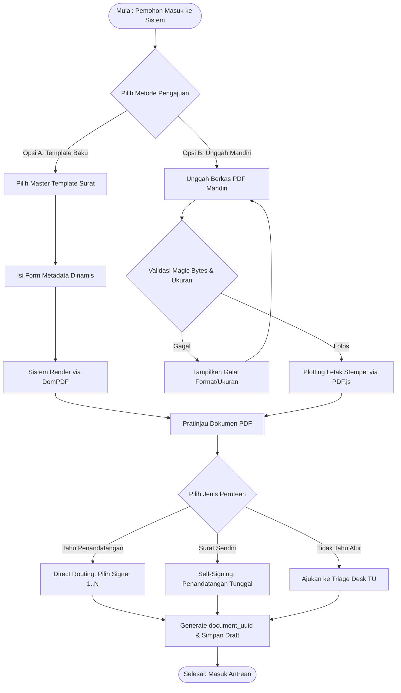
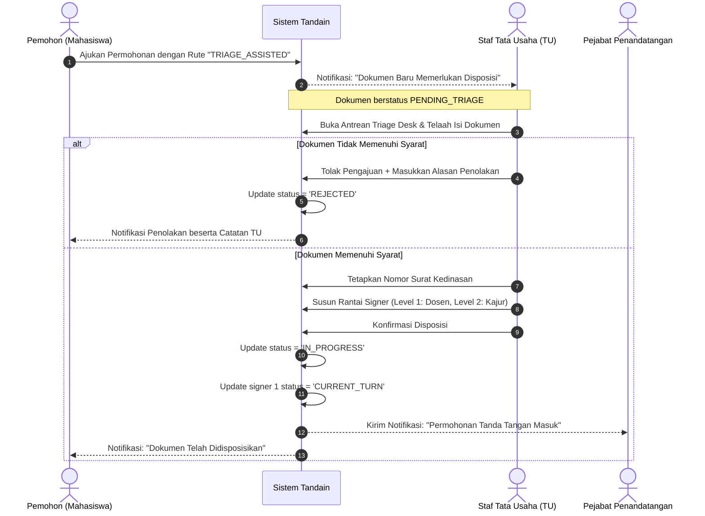
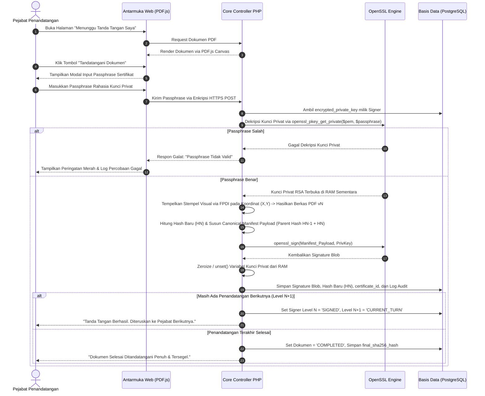
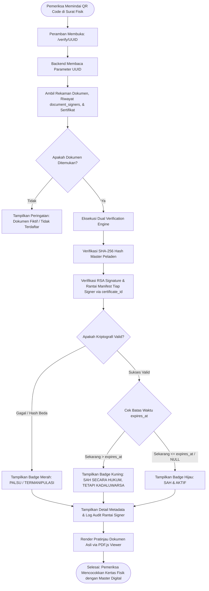

# DOKUMEN 03: CETAK BIRU ALUR KERJA (WORKFLOW) DAN PANDUAN DESAIN UI/UX
## Sistem Tanda Tangan Elektronik Kampus "Tandain"
**Jurusan Teknik Informatika dan Komputer — Politeknik Negeri Jakarta**

---

## 1. CETAK BIRU ALUR KERJA SISTEM (WORKFLOW & USER JOURNEY)

Sistem **Tandain** mengotomasi proses persuratan kampus melalui 4 (empat) alur kerja utama yang memadukan fleksibilitas administrasi dan ketatnya jaminan integritas kriptografis.

---

### 1.1 Alur 1: Pengajuan Dokumen (Unggah PDF Mandiri vs Template DomPDF)

Alur ini memfasilitasi pembuatan berkas awal oleh Pemohon (*Requester*), baik dari format template baku jurusan maupun berkas PDF eksternal.



#### Tahapan Rinci:
1. **Opsi A (Template Surat Baku DomPDF):**
   * Pemohon memilih jenis surat (misal: *Surat Keterangan Aktif Kuliah*, *Surat Rekomendasi Magang/PKL*).
   * Sistem menyajikan formulir dinamis berisi masukan teks: Keperluan, Semester, Nama Perusahaan Tujuan, dsb.
   * Data diinjeksi ke tag placeholder `{{...}}` di template HTML dan dikonversi menjadi berkas PDF murni oleh engine DomPDF.
2. **Opsi B (Unggah PDF Mandiri):**
   * Digunakan untuk dokumen bebas seperti Lembar Pengesahan Skripsi atau Proposal Ormawa.
   * Pemohon mengunggah berkas PDF (maksimal 10 MB). Sistem memeriksa *magic bytes* (`%PDF-`).
   * Menggunakan kanvas interaktif berbasis PDF.js, pemohon mengklik halaman tertentu untuk menetapkan kotak area penandatanganan (Signer 1, Signer 2). Koordinat disimpan dalam database.

---

### 1.2 Alur 2: Alur Disposisi & Triage oleh Admin Tata Usaha (TU)

Alur ini menjadi jembatan birokrasi kampus ketika mahasiswa atau pemohon awam tidak mengetahui struktur rantai pejabat yang berwenang menandatangani surat terkait.



---

### 1.3 Alur 3: Penandatanganan Berantai (Sequential Signing) & Eksekusi Passphrase

Menjamin kepatuhan urutan pejabat struktural serta perlindungan identitas penandatangan menggunakan *passphrase-protected in-memory decryption*.



---

### 1.4 Alur 4: Verifikasi Publik Nir-Hambatan (Scan QR Code & Pratinjau Pembanding)

Alur verifikasi terbuka bagi masyarakat, perusahaan mitra industri, atau instansi penerima berkas fisik hasil cetak. Portal verifikasi menyediakan **Dual Verification**: memeriksa integritas kriptografi berkas di peladen dan menampilkan *Embedded PDF.js Viewer* agar pemeriksa dapat mencocokkan teks fisik di kertasnya secara visual dengan master digital asli di peladen.



---

## 2. PANDUAN DESAIN ANTARMUKA PENGGUNA (UI/UX DESIGN DIRECTION)

Antarmuka **Tandain** dirancang untuk memancarkan wibawa institusional akademik, keamanan tingkat militer, dan kebersihan operasional tinggi.

### 2.1 Filosofi Desain & Acuan Design System
1. **Google Workspace Design Philosophy:** Mengadopsi kesederhanaan tata letak (*clarity*), ruang kosong yang lega (*spacious whitespace*), navigasi minimalis, dan hierarki visual yang jelas untuk menghindari kelelahan kognitif staf akademik.
2. **IBM Carbon Design System:** Menerapkan ketegasan batas kontur (*crisp borders*), kartu informasi berdensitas tinggi untuk log audit teknis, tipografi berbasis grid modular, serta sistem status penandaan berbasis token warna fungsional yang kuat.
3. **Nielsen Norman Usability Heuristics:**
   * *Visibility of System Status:* Penanda tahapan penandatanganan berbentuk *stepper* horizontal yang menunjukkan secara gamblang siapa yang sedang memegang berkas saat ini.
   * *Recognition over Recall:* Menghadirkan panel bantuan contekan tag (*cheat sheet*) interaktif di samping form pembuat template agar Admin TU tidak perlu mengingat format tag variabel.

---

### 2.2 Spesifikasi Tipografi (Typography)

Sistem membedakan secara tegas antara tipografi antarmuka aplikasi web modern dengan tipografi naskah dinas kedinasan:

| Lingkungan Penggunaan | Rumpun Huruf (Font Family) | Bobot (Weight) | Ukuran (Size) & Line Height | Karakteristik & Justifikasi |
| :--- | :--- | :---: | :---: | :--- |
| **Web UI Heading (H1-H3)** | **Montserrat** | Bold (700) / SemiBold (600) | 24px – 32px (1.2) | Geometris, modern, tegas, memberikan kesan platform teknologi digital yang kokoh dan terpercaya. |
| **Web UI Body Text** | **Montserrat** | Regular (400) / Medium (500) | 14px – 16px (1.5) | Keterbacaan tinggi pada layar beresolusi tinggi, spasi huruf proporsional untuk teks instruksi dan tabel. |
| **Data Teknis / Hash Kripto** | **JetBrains Mono / Courier New** | Regular (400) | 12px – 13px (1.4) | Monospace. Memudahkan mata membedakan karakter unik pada SHA-256 digest dan public key certificate. |
| **Dokumen Naskah Dinas PDF** | **Times New Roman** | Regular / Bold | 12pt (Line spacing: 1.5) | Standar naskah dinas resmi instansi pemerintah dan perguruan tinggi vokasi (Permenristekdikti / Tata Naskah Dinas PNJ). |

---

### 2.3 Palet Warna Semantik & Desain Token (WCAG 2.1 Level AA)

Setiap warna memiliki makna fungsionalitas status yang konsisten di seluruh layar sistem:

```
[ Deep Trust Blue: #1E3A8A ]  -> Identitas Kampus & Keamanan Utama
[ Secure Teal:     #0D9488 ]  -> Operasi Kriptografi & Proteksi Kunci
[ Slate 900:       #0F172A ]  -> Teks Kontras Tinggi (Rasio 14:1)
[ Success Green:   #16A34A ]  -> Status Sah, Valid & Aktif
[ Warning Amber:   #D97706 ]  -> Kadaluwarsa / Menunggu Disposisi
[ Error Rose:      #E11D48 ]  -> Bahaya, Dokumen Palsu, Galat Passphrase
```

#### Spesifikasi Token & Rasio Kontras:

| Nama Token Warna | Nilai Heksadesimal | Penerapan Antarmuka | Rasio Kontras (pada latar putih) | Standar WCAG 2.1 AA |
| :--- | :---: | :--- | :---: | :---: |
| **Deep Trust Blue** | `#1E3A8A` | Header navigasi, tombol aksi utama (*Primary CTA*), border aktif. | **9.1 : 1** | Lolos (Target $\ge 4.5:1$) |
| **Secure Teal** | `#0D9488` | Ikon gembok kriptografi, kartu sertifikat aktif, indikator enkripsi. | **4.6 : 1** | Lolos (Target $\ge 4.5:1$) |
| **Slate 900 (Dark)** | `#0F172A` | Teks utama, judul halaman, tabel header. | **15.8 : 1** | Lolos Mutlak (Target $\ge 4.5:1$) |
| **Slate 100 (Surface)**| `#F1F5F9` | Latar belakang kanvas aplikasi, pembungkus kartu (*container*). | - | Netral Lembut |
| **Success Green** | `#16A34A` | Badge "Sah & Aktif", ikon centang tanda tangan selesai. | **4.7 : 1** | Lolos (Target $\ge 4.5:1$) |
| **Success Light (Bg)** | `#DCFCE7` | Latar badge sukses verifikasi. | - | Latar Kontras Rendah |
| **Warning Amber** | `#D97706` | Badge "Kadaluwarsa", antrean "Pending Triage". | **4.5 : 1** | Lolos (Target $\ge 4.5:1$) |
| **Warning Light (Bg)** | `#FEF3C7` | Latar badge peringatan kadaluwarsa. | - | Latar Kontras Rendah |
| **Error Rose** | `#E11D48` | Badge "Manipulasi Terdeteksi", peringatan gagal passphrase. | **4.8 : 1** | Lolos (Target $\ge 4.5:1$) |
| **Error Light (Bg)** | `#FFE4E6` | Latar peringatan berkas palsu/rusak. | - | Latar Kontras Rendah |

---

### 2.3 Pedoman Desain Komponen Pemilih Penandatangan Berbasis Email (Anti-Dropdown Pattern)

Menghindari penggunaan elemen `<select>` dropdown konvensional yang memuat ribuan civitas secara mentah, antarmuka pengajuan dokumen menerapkan **Komponen Pencarian Penandatangan Berbasis Email Asinkron (*Debounced Email Search & Typeahead*)**.

#### A. Alasan Penolakan Model Dropdown Tradisional:
1. **Performa & DOM Bloat:** Memuat ribuan baris nama mahasiswa dan dosen ke dalam tag `<option>` menyebabkan perlambatan rendering peramban (*UI freeze* / *jank*).
2. **Ambiguitas Homonim:** Nama dosen atau mahasiswa sering kali memiliki kemiripan atau kesamaan nama lengkap (*homonim*). Alamat email resmi (`@pnj.ac.id` / `@stu.pnj.ac.id`) adalah satu-satunya pengenal unik (*unique institutional identifier*) yang menjamin surat tidak salah sasaran.
3. **Privasi Direktori:** Mencegah ekstraksi massal seluruh daftar civitas kampus melalui inspeksi kode HTML.

#### B. Mockup Komponen Pencarian & Pratinjau Target:
```
+-----------------------------------------------------------------------------+
| PENENTUAN ALUR PENANDATANGAN DOKUMEN                                        |
+-----------------------------------------------------------------------------+
| Cari Target Penandatangan (Dosen / Mahasiswa / Pejabat TU):                 |
| +---------------------------------------------------------+---------------+ |
| | Masukkan email resmi PNJ (contoh: anita.h@pnj.ac.id)    | [ Cari 🔍 ]   | |
| +---------------------------------------------------------+---------------+ |
| [*] Ketik otomatis (auto-search 500ms delay) atau tekan Enter / tombol Cari |
|                                                                             |
| HASIL PENCARIAN DITEMUKAN:                                                  |
| +-------------------------------------------------------------------------+ |
| | [Foto/Inisial] Anita Hidayati, S.Kom., M.Kom.                           | |
| |                Email : anita.h@pnj.ac.id | NIP: 197908102008122002      | |
| |                Status: Dosen / Sekretaris Jurusan TIK                   | |
| |                [Badge Hijau: Sertifikat TTE Aktif (RSA-2048)]           | |
| |                                                [ + Tambah ke Urutan ]   | |
| +-------------------------------------------------------------------------+ |
|                                                                             |
| DAFTAR URUTAN PENANDATANGAN TERPILIH (SEQUENTIAL ROUTE):                    |
| [1] Dr. Ir. Iwan Sonjaya, M.T. (iwan.s@pnj.ac.id)   - Hal: 1 [QR + TTD] [x] |
| [2] Anita Hidayati, S.Kom., M.Kom. (anita.h@pnj.ac.id) - Hal: 2 [QR Saja] [x] |
+-----------------------------------------------------------------------------+
```

#### C. Spesifikasi Interaksi Frontend:
1. **Dual Search Trigger (Hybrid UX):**
   * **Auto-Search (Debounced):** Menggunakan timer `setTimeout` 500–800ms setelah pengguna berhenti mengetik. Jika pengguna masih mengetik, timer di-reset (`clearTimeout`).
   * **Explicit Search:** Menekan tombol "Cari" atau menekan tombol `Enter` membatalkan timer debounce dan langsung mengeksekusi request `fetch('/api/users/search?email=' + encodeURIComponent(query))`.
2. **Indikator Status (Visual Feedback):**
   * Saat pencarian berlangsung: Tampilkan ikon spinner animasi pemuatan (*Loading state*).
   * Jika email tidak ditemukan: Tampilkan kartu peringatan amber: *"Pengguna dengan email tersebut belum terdaftar di sistem Tandain."*
   * Jika pengguna belum memiliki sertifikat TTE: Munculkan tag peringatan ringan: *"Pengguna belum mengaktifkan sertifikat TTE digital (tetap dapat ditambahkan, notifikasi aktivasi akan dikirimkan saat giliran tiba)."*

---

## 3. PEDOMAN PERANCANGAN FORM BUILDER TEMPLATE ADMIN TU

Guna mencegah galat format pengetikan tag pada template surat resmi serta menjamin konsistensi visual naskah dinas PNJ, modul perancangan template menerapkan layout dua kolom (*Split-Screen Builder*) yang mengimplementasikan prinsip *Recognition over Recall*.

```
+-----------------------------------------------------------------------------+
| FORM BUILDER TEMPLATE SURAT DINAS JURUSAN TIK PNJ                           |
+------------------------------------+----------------------------------------+
| KOLOM KIRI (70%): EDITOR BADAN     | KOLOM KANAN (30%): PANEL CONTEKAN TAG  |
| SURAT (BODY CONTENT SAJA)          | (CHEAT SHEET & CLICK-TO-INSERT)        |
|                                    |                                        |
| [Judul Template:                 ] | Klik tag untuk menyisipkan ke kursor:  |
| [Surat Keterangan Aktif Kuliah   ] |                                        |
| [Kode: SK-AKTIF-KULIAH           ] | [A. DATA MAHASISWA OTOMATIS (SISTEM)]  |
|                                    | (Otomatis ditarik dari profil login)   |
| +---[ KOP SURAT PNJ: FIXED ]-----+ | * [ {{nama_lengkap}}  ] [Sisip Tag]    |
| | (Logo PNJ & Kop resmi kampus   | | * [ {{nomor_induk}}   ] [Sisip Tag]    |
| |  terpasang otomatis di sistem) | | * [ {{program_studi}} ] [Sisip Tag]    |
| +--------------------------------+ | * [ {{email}}         ] [Sisip Tag]    |
| | <p>Yang bertanda tangan di     | |                                        |
| | bawah ini Ketua Jurusan TIK    | | [B. ISIAN FORMULIR PEMOHON (INPUT)]   |
| | menerangkan bahwa:</p>         | | (Diisi mahasiswa di form pengajuan)   |
| | <p>Nama: {{nama_lengkap}}</p>  | | * [ {{keperluan}}     ] [Sisip Tag]    |
| | <p>NIM : {{nomor_induk}}</p>   | | * [ {{instansi_tujuan}} ] [Sisip Tag]  |
| | <p>Untuk: {{keperluan}}</p>    | |                                        |
| |                                | | [C. ATRIBUT KEDINASAN & TTE]           |
| | <table class="table-ttd">      | | * [ {{nomor_surat}}   ] [Sisip Tag]    |
| |   <tr><td>{{kolom_ttd_1}}</td> | | * [ {{tanggal_surat}} ] [Sisip Tag]    |
| |   <td>{{kolom_ttd_2}}</td></tr>| | * [ {{kolom_ttd_1}}   ] [Sisip Tag]    |
| | </table>                       | | * [ {{kolom_ttd_2}}   ] [Sisip Tag]    |
| +---[ FOOTER LEGALITAS: FIXED ]--+ | * [ {{qr_verifikasi}} ] [Sisip Tag]    |
|                                    |                                        |
| [ Simpan Draf ] [ Uji Render PDF ] | [!] Kop & Footer resmi telah otomatis  |
|                                    | dibungkus oleh layout sistem (DomPDF). |
+------------------------------------+----------------------------------------+
```

### 3.1 Aturan Fungsional Form Builder:
1. **Fixed Layout Master Wrapper:**
   Admin TU tidak perlu menyusun kode HTML untuk Kop Surat (logo PNJ, alamat kampus, garis ganda) dan footer kedinasan. Sistem otomatis membungkus teks badan surat ke dalam master wrapper terstandar (`templates/layouts/official_letter_kop.html.php`).
2. **Interactive Click-to-Insert:**
   Setiap item pada panel contekan kanan dilengkapi tombol interaktif. Ketika diklik, skrip JavaScript menyisipkan string tag tepat pada posisi kursor aktif di editor kode teks sebelah kiri (`textarea.setRangeText()`), menghilangkan potensi salah eja (*typo*).
3. **Pemisahan Variabel Profil vs Variabel Input Form:**
   Variabel profil (`{{nama_lengkap}}`, `{{nomor_induk}}`, `{{program_studi}}`) otomatis terisi dari sesi akun pemohon tanpa perlu diketik oleh mahasiswa, menjamin integritas data pemohon.
4. **Pratinjau Instan (*Live Sandbox Rendering*):**
   Admin TU dapat mengklik tombol "Uji Render PDF". Sistem mengirimkan konten draf ke engine DomPDF dengan data *dummy/mock* dan langsung memunculkan berkas PDF hasil di jendela *modal pop-up* untuk memastikan batas margin, jarak spasi baris, dan kerapian naskah dinas sebelum disimpan ke basis data produksi.

---

## 4. ARSITEKTUR NAVIGASI BILAH SISI (SIDEBAR HIERARCHY)

Mengadopsi pola tata kelola persuratan kampus terbukti (mengacu pada benchmark empiris IPB DiSign di Dokumen 05), bilah sisi (*sidebar*) aplikasi disusun dengan pemisahan peran dan alur yang tegas:

```
[ TANDAIN CORE SIDEBAR ]
  │
  ├── 🏠 Beranda               -> Dashboard analitik status berkas & ringkasan aktivitas
  │
  ├── 📥 Permintaan            -> KOTAK MASUK (INBOX): Daftar surat dari orang lain yang menunggu TTD Anda
  │                                (Review dokumen -> Masukkan Passphrase -> Setujui / Tolak)
  │
  ├── ✍️ Tanda Tangani         -> JALUR KILAT SELF-SIGNING: Tanda tangani dokumen sendiri secara instan
  │                                (Upload PDF -> Tentukan posisi stempel -> Input Passphrase -> Terbit)
  │
  ├── 📁 Dokumen (Dropdown):
  │     ├── 📤 Unggah          -> Formulir pengajuan surat ke orang lain (Multi-TTD, Urutan, Template)
  │     ├── 📄 Diunggah        -> Arsip berkas yang DIAJUKAN OLEH ANDA (Unduh Original vs Signed, Detail)
  │     └── 📑 Ditandatangani  -> Arsip berkas yang TELAH ANDA TANDATANGANI (Arsip wewenang & nomor seri cert)
  │                               *(Catatan: Pengesahan Tugas Akhir dikelola via Template Surat Baku, BUKAN menu tersendiri di sidebar)*
  │
  ├── ⚙️ Pengaturan (Dropdown):
  │     ├── 🔐 Sertifikat Digital  -> Manajemen pasangan kunci (1 User = 1 Aktif, 1 Tahun, Revoke)
  │     └── 🖋️ Gambar Tanda Tangan -> Manajemen spesimen visual TTD utama (Upload PNG transparan / Draw Canvas)
  │                               *(Catatan: Spesimen disederhanakan 1 tanda tangan resmi, fitur paraf kertas dieliminasi)*
  │
  └── 🔍 Verifikasi            -> Portal verifikasi publik tanpa login (Scan QR / Upload PDF)
```

